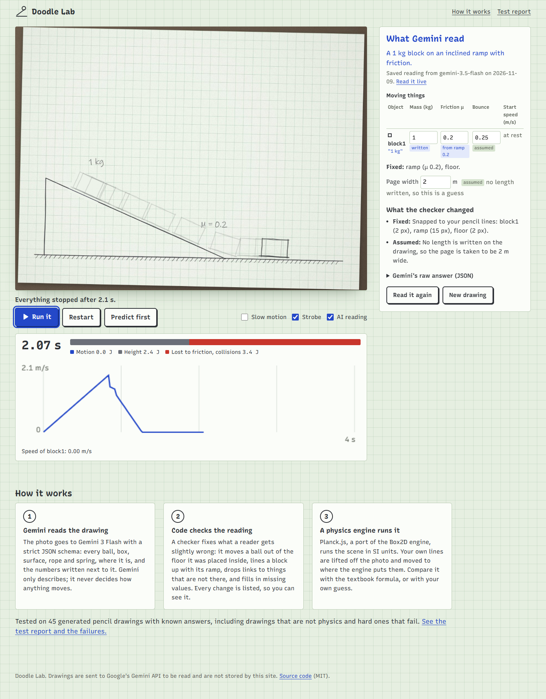
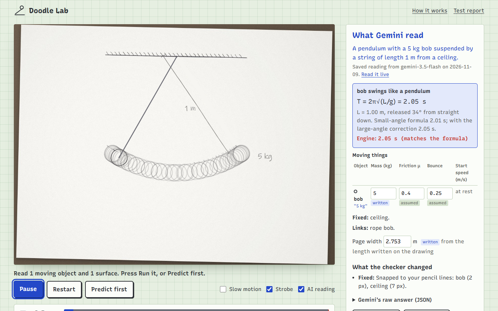
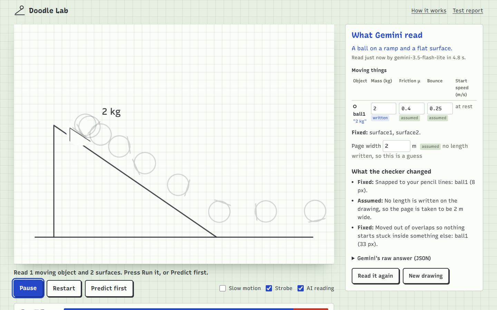

# Doodle Lab

**Draw an experiment. Watch it run.**

Photograph a pencil sketch of a physics setup (a block on a ramp, a pendulum, two balls about to collide, a seesaw) and it comes alive. Gemini reads the drawing into strict JSON, code checks and snaps that reading onto your pencil lines, and a real physics engine runs it. Your own lines are lifted off the paper and moved to where the engine puts them.

The AI only reads. The engine computes every bit of motion.

**Try it:** https://doodle-lab.pages.dev (open a sample drawing, or press "Draw on screen")

**Test report with every failure:** https://doodle-lab.pages.dev/report

**Demo video (2:25):** https://youtu.be/EpLo6ND3B1g



## Who it is for

Students learning mechanics, and their teachers. Physics students draw these diagrams all the time, but a drawing never moves, so you never find out whether your intuition was right. Doodle Lab lets you:

- **Run your own diagram**, from a photo, an upload, or a drawing on the screen.
- **Change the numbers** after it is read (mass, friction, bounce, starting speed, spring constant, page scale) and run it again. The sample ramp is 24°; tan 24° = 0.45, so at μ = 0.2 the block slides, and at μ = 0.5 it stays put.
- **Predict first**: tap where you think the object will stop, then see how far off you were.
- **Check the textbook**: for a pendulum or a mass on a spring the app shows the formula (T = 2π√(L/g), T = 2π√(m/k)) next to the period the engine measures.
- **Watch energy**: bars for motion, height, spring and energy lost to friction and collisions, and a speed graph.

## How it works

1. **Gemini reads the drawing.** The photo (downscaled to 1280 px, in the browser) goes to a Cloudflare Pages Function, which calls the Gemini API with a JSON schema (`src/read/schema.ts`): balls and boxes as tight boxes on a 0–1000 grid, surfaces as point lists, anchors, links (rope, rod, spring, pin), length labels, and the numbers written beside each thing (mass, μ, e, k, arrow speed). The model is told to describe only what is drawn and to say when a drawing is not physics.
2. **Code snaps the reading to the pencil.** `src/read/refine.ts` builds an "ink map" from the photo and moves each circle, box, line and rope end to where the pencil marks actually are, only when the new place sits clearly better on the ink. It never adds or removes anything.
3. **Code checks the reading.** `src/scene/validate.ts` turns the untrusted JSON into a scene: drops what cannot run, clamps impossible values, takes the scale from a written length, pushes a ball out of a floor it was placed inside, lines a block up with the slope under it, puts a seesaw's pivot on the corner of its fulcrum, and fills in missing values. Every change is listed on screen ("Fixed", "Assumed", "Left out").
4. **A physics engine runs it.** [Planck.js](https://github.com/piqnt/planck.js) (a JavaScript port of Box2D) runs the scene in SI units at 480 steps a second. Written friction is the friction between the two things touching (Box2D's own √(μa·μb) mixing would change a written μ).
5. **Your lines move.** `src/ui/cutout.ts` cuts each moving shape out of the photo (paper made transparent, graphite kept), paints the paper colour where it was, and draws it at the engine's position and angle. Ropes and springs are redrawn live.

### Which model

| Order | Model | Why |
| --- | --- | --- |
| 1 | `gemini-3-flash-preview`, low thinking | Very precise in testing (mean position error 0.9/1000), about 9 s: first because it is about twice as fast as 3.5 Flash |
| 2 | `gemini-3.5-flash`, low thinking | Most precise (0.7/1000), but about 17 s |
| 3 | `gemini-3.5-flash-lite`, low thinking | About 3 s; good enough with snapping (below) |
| 4 | `gemini-3.1-flash-lite` | Last resort |

The free API tier allows 20 requests a day for each of the first two, so most live reads use model 3. The page always says which model read the drawing. The six sample drawings open with a reading saved from a real Gemini call (labelled as saved, with the model and date), and "Read it live" sends the photo again.

### A representative input and output

Input: `public/samples/sample-pendulum.jpg`. Output from `gemini-3.5-flash` (shortened):

```json
{
  "isPhysicsSketch": true,
  "whatIsIt": "A pendulum with a 5 kg bob suspended by a string of length 1 m from a ceiling.",
  "balls": [{ "id": "bob", "box_2d": [498, 683, 573, 737], "label": "5 kg", "massKg": 5, "friction": -1, "bounce": -1, "fixed": false }],
  "surfaces": [{ "id": "ceiling", "points": [[134, 285], [134, 725]], "label": "", "friction": -1 }],
  "anchors": [{ "id": "pivot", "point": [134, 508] }],
  "links": [{ "kind": "rope", "from": "pivot", "fromPoint": [134, 508], "to": "bob", "toPoint": [506, 695], "stiffnessNpm": -1 }],
  "measurements": [{ "from": [134, 465], "to": [532, 672], "meters": 1, "label": "1 m" }]
}
```

The app turns that into a 1.00 m pendulum released 34° from straight down. The formula with the large-angle correction gives 2.05 s; the engine measures 2.05 s.



## How it was tested

**Reading drawings** (`npm run eval`, results in [docs/EVAL.md](docs/EVAL.md) and on the [test report page](https://doodle-lab.pages.dev/report)). 45 drawings generated by `eval/gen/` from known scenes: 12 kinds of setup in 3 variations each (sizes, angles, labels, mirrored, plain/lined/squared/cream paper, pencil or pen, three handwriting fonts, desk edges, uneven light, rotation, blur, some drawn "on screen"), 4 drawings that are not physics (a house with a sun, a shopping list with "2 kg" on it, noughts and crosses, a blank page) and 5 deliberately hard ones. Each drawing is sent with the app's own prompt and schema, then scored against the scene that was drawn. A case passes only if every object is found and none invented, every surface is traced within 2% of the image, every written number is read correctly, every link is attached to the right thing, the scale is right, and the engine moves the read scene the same way as the drawn one.

| Model | Cases | Pass, AI + snapping | Pass, AI alone | Labels read correctly | Not physics, refused | Mean position error | Median time |
| --- | --- | --- | --- | --- | --- | --- | --- |
| Gemini 3.5 Flash-Lite (low thinking) | 45 | **35/45** | 29/45 | 55/55 | 4/4 | 2.4/1000 | 2.9 s |
| Gemini 3.5 Flash (low thinking) | 12 (dev set) | 11/12 | 9/12 | 15/16 | – | 0.7/1000 | 17.1 s |
| Gemini 3 Flash (low thinking) | 9 of 12 (quota ran out) | 8/9 | 7/9 | 12/13 | – | 0.9/1000 | 9.3 s |
| Gemini 3.1 Flash-Lite | 12 (dev set) | 5/12 | 4/12 | 13/16 | – | 5.2/1000 | 2.9 s |

The prompt was tuned on the 12 "dev" drawings only; the other 33 were not looked at while tuning. Snapping to the pencil lines turns 6 failures into passes for Gemini 3.5 Flash-Lite and halves its mean position error on normal drawings (5.3 → 2.6 thousandths of the image). In these runs, for the four models the app uses, it never turned a pass into a fail (it did for two settings the app does not use: 3.5 Flash-Lite with default thinking and 3.1 Flash-Lite with high thinking).

**The engine against textbook physics** (`npm test`, 70 tests): a free fall matches √(2h/g) within 2%; a pendulum matches 2π√(L/g) with the large-angle correction within 2%; a mass on a spring matches 2π√(m/k) within 3%; a block on a 30° ramp holds at μ = 0.7 and slides at g(sin θ − μ cos θ) at μ = 0.2 within 5%; a μ written by the ramp applies to the block, and the block's own μ wins; a rigid pendulum loses under 1% of its energy per second (a known Box2D effect that shrinks with the step size, which is why the engine runs 480 steps a second); the same scene always runs the same way. The checker is tested against garbage JSON, non-physics drawings, overlaps, wrong tilts, impossible values and broken links; the scorer is tested to pass a perfect reading of all 45 cases and fail planted mistakes.

**The app in a real browser**: `scripts/e2e.mjs` draws a ramp, a ball and a "2 kg" label on the pad in Edge, reads it through the real `/api/read` function and Gemini, runs it and checks the ball moves; `scripts/shots.mjs` goes through the samples, prediction, the pad and a phone-sized screen.

## Failure cases and limits

- **Towers of blocks fail every time** (0/3 plus the hard portrait version). Knocking over a tower is chaotic: a block a few pixels wider topples differently, so the run does not match the drawn scene even when the reading is good.
- **Lines placed a little off.** The Flash-Lite models sometimes put a floor or ramp 3–8% of the image away from the pencil line. Snapping fixes errors up to about 3.5%. A wider search scored worse overall (it can snap onto hatching or ruled lines), so it was not kept. In the screenshot below, from the end-to-end test, Gemini 3.5 Flash-Lite placed the ramp above the drawn one, so the ball rolls on a line slightly above the pencil.
- **Curved ramps** need many points; the reader gives too few, so the ball rolls on a straighter slope (hard case "curve" fails).
- **Collisions are sensitive.** A 1-pixel change in where two balls touch tilts the bounce.
- **Generated drawings only.** The test set is rendered by code so every answer is known. Real phone photos of real pencil drawings have not been scored yet.
- **2D only**, and a "ball" is a disc to the engine, so it rolls like a coin (v = √(4gh/3) down a slope, not √(10gh/7) like a solid sphere). No air resistance or rolling resistance.
- Without a written length the page is assumed to be 2 m wide; you can change it.



## Privacy and safety

The photo is downscaled in the browser and sent to the Gemini API through this site's server function to be read; the site does not store or log drawings. The API key stays on the server (a Cloudflare Pages secret). The function only accepts same-origin JSON requests with a JPEG, PNG or WebP under about 1.5 MB, limits each visitor to about 40 reads an hour (best effort), and stops the whole site at 300 reads a day (a Workers KV counter) so the free API quota, shared with other demos, cannot be used up.

## Run it yourself

```bash
npm install
cp .dev.vars.example .dev.vars   # put a Gemini API key in it
npm test                         # engine, checker and scorer tests
npm run pages:dev                # app + /api/read on http://localhost:8788
npm run gen                      # regenerate the 45 test drawings and 6 samples (needs Edge)
npm run eval -- --model gemini-3.5-flash-lite@low --split all
node --experimental-strip-types eval/publish.ts   # docs/EVAL.md and the report page data
```

Deploy: `npx wrangler pages deploy dist --project-name doodle-lab` (`wrangler.toml` binds the KV namespace for the daily cap), and set the key with `npx wrangler pages secret put GEMINI_API_KEY --project-name doodle-lab`.

## Built with

TypeScript, Vite, [Planck.js](https://github.com/piqnt/planck.js) (MIT) for physics, the [Recursive](https://www.recursive.design/) typeface (SIL Open Font License) via Fontsource, the Gemini API (Google), Cloudflare Pages and Pages Functions, Vitest, and Playwright with Microsoft Edge for browser tests and the test drawings.

Everything here was written for AI OpenBuild in November 2026. Two small pieces were adapted from the author's earlier project Plain Page: the Gemini JSON client with model fallback (`src/read/gemini.ts`, extended here for images and thinking levels) and the request guard (`src/server/guard.ts`).

## Licence

MIT. See [LICENSE](LICENSE).
